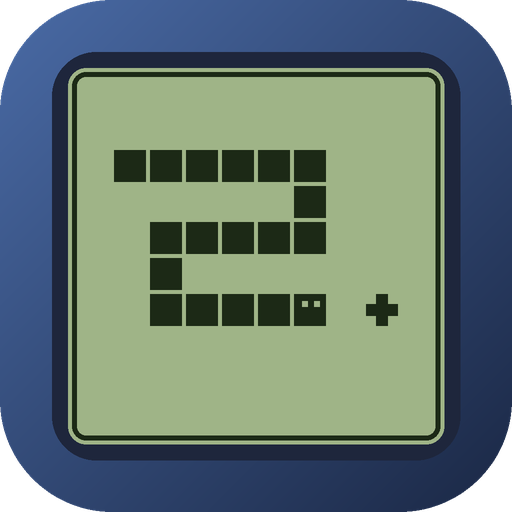
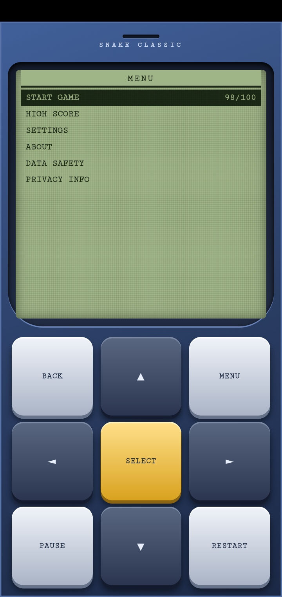

  

<h1 align="center">🐍 Classic Nokia Snake Game 📱</h1>

  A retro, Nokia-style Snake game for Android. Green LCD screen, pixel snake, real keypad buttons. 100% offline.

---

## 📥 Download

**[⬇️ Download APK](https://github.com/KSURitam/classic_nokia_snake_game/releases/tag/Apk)**

📲 Requires Android 5.0 or newer.

## 🛠️ How to install

- 1️⃣ Download the APK from the link above.
- 2️⃣ Open the downloaded file.
- 3️⃣ If Android asks, allow installs from your browser or file manager.
- 4️⃣ Tap **Install** and open **Classic Nokia Snake Game**.

## ✨ Features

- 🟩 Classic monochrome LCD look with a pixelated snake and food
- 📟 Nokia-style phone body with working keypad: arrows, SELECT, BACK, MENU, PAUSE and RESTART
- 👆 Swipe controls and keyboard support
- ⚡ Speed increases as your score grows, up to a maximum
- 🎚️ Difficulty levels: Easy, Normal and Hard
- 🪙 Daily token system: 100 tokens per day, 1 token is used each time a game ends, and tokens refill the next day
- 🏆 High score saved on your phone, with reset confirmation
- ⚙️ Settings: sound, difficulty, speed, vibration, swipe controls, key beep and fullscreen
- 📱 Portrait layout made for smartphones

## 🎨 Theme

Inspired by the classic Nokia 3310 era:

- 🟢 Monochrome green LCD screen with dark pixel graphics, like an old Nokia display
- 🔵 Blue phone body with a speaker slit and raised, physical-looking keypad buttons
- 🐍 Pixel-style snake and food on a bordered play area
- 📋 Simple Nokia-style menu list with a highlighted selection bar

## 🎮 Controls

| Action | Keypad | Touch | Keyboard |
|---|---|---|---|
| Move | Arrow buttons | Swipe on the screen | Arrow keys or W A S D |
| Select | SELECT | Tap the menu item | Enter |
| Back | BACK | | Esc |
| Menu | MENU | | M |
| Pause / resume | PAUSE | | P |
| Restart | RESTART | | R |

## 🔒 Privacy and data safety

- 📴 Works fully offline. No internet permission.
- 🚫 No ads, no tracking, no analytics, no account or login.
- 💾 Only your settings, high score and daily token count are saved on your device.
- 🔓 Saved data is local but not encrypted.

## 📸 Screenshots

  

## ⚠️ Disclaimer

Classic Nokia Snake Game is inspired by classic Nokia-era Snake gameplay. It is an independent fan project and is not an official Nokia product. It is not affiliated with or endorsed by Nokia.
